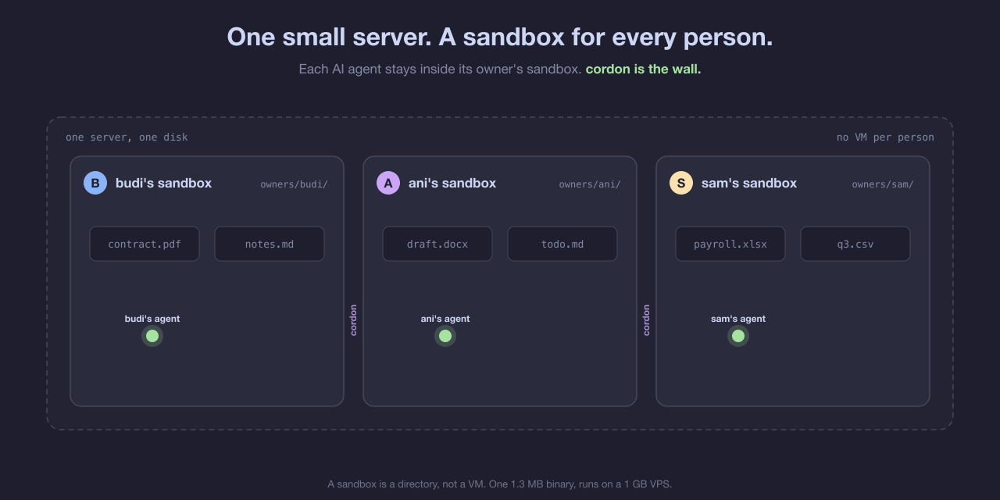
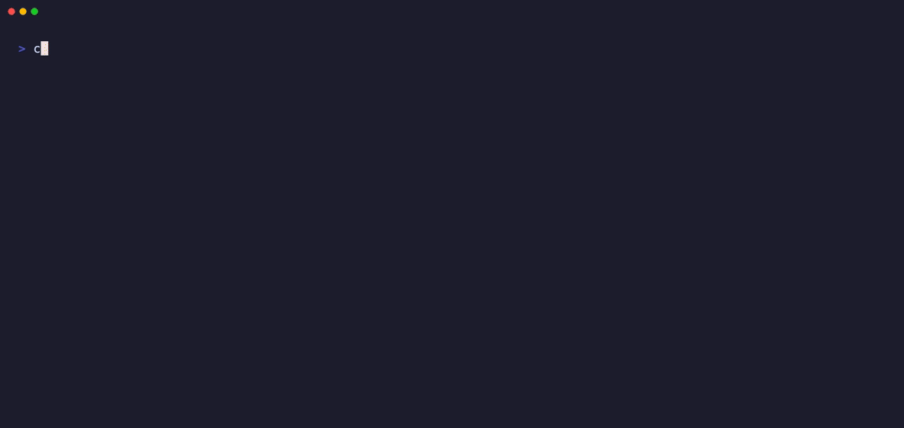
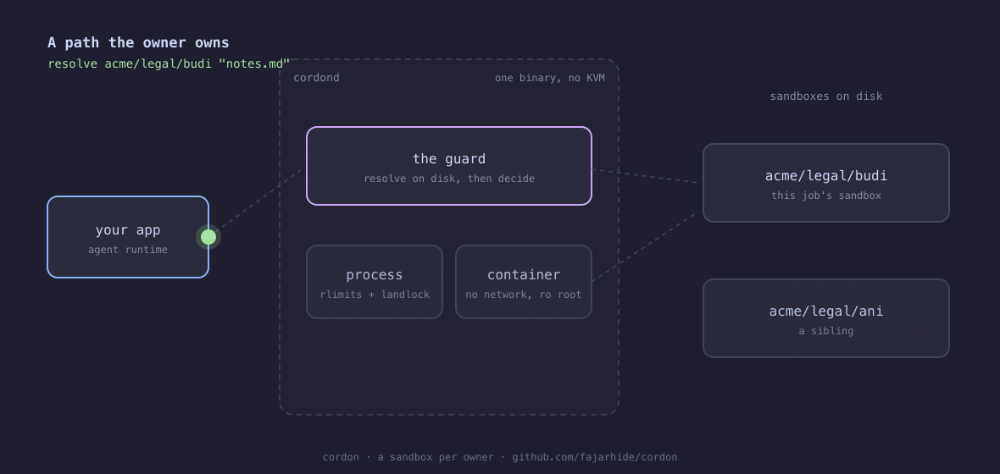
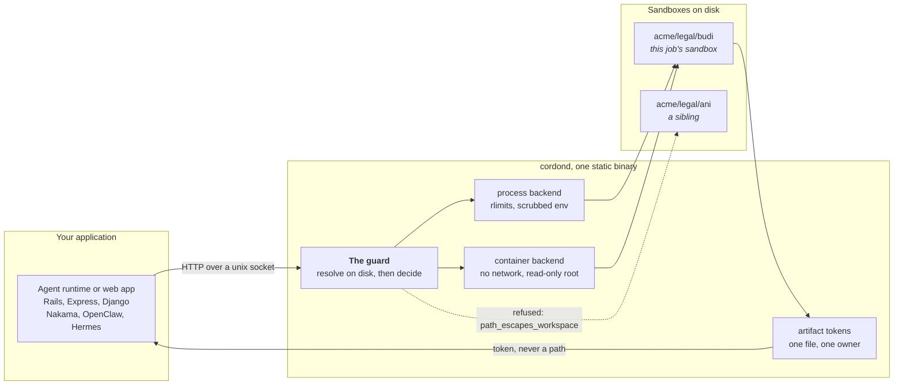
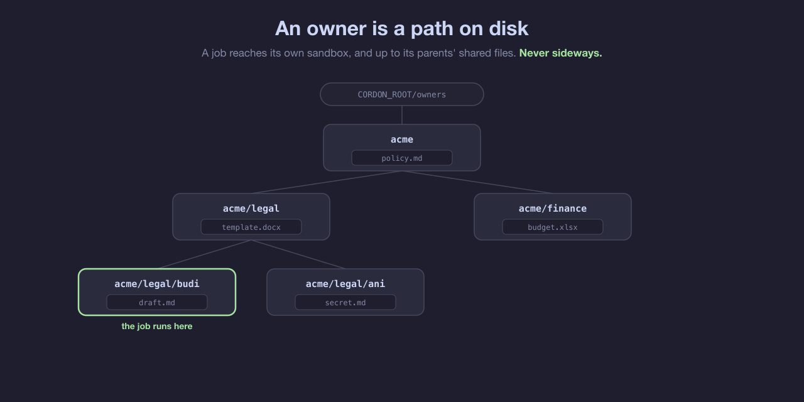
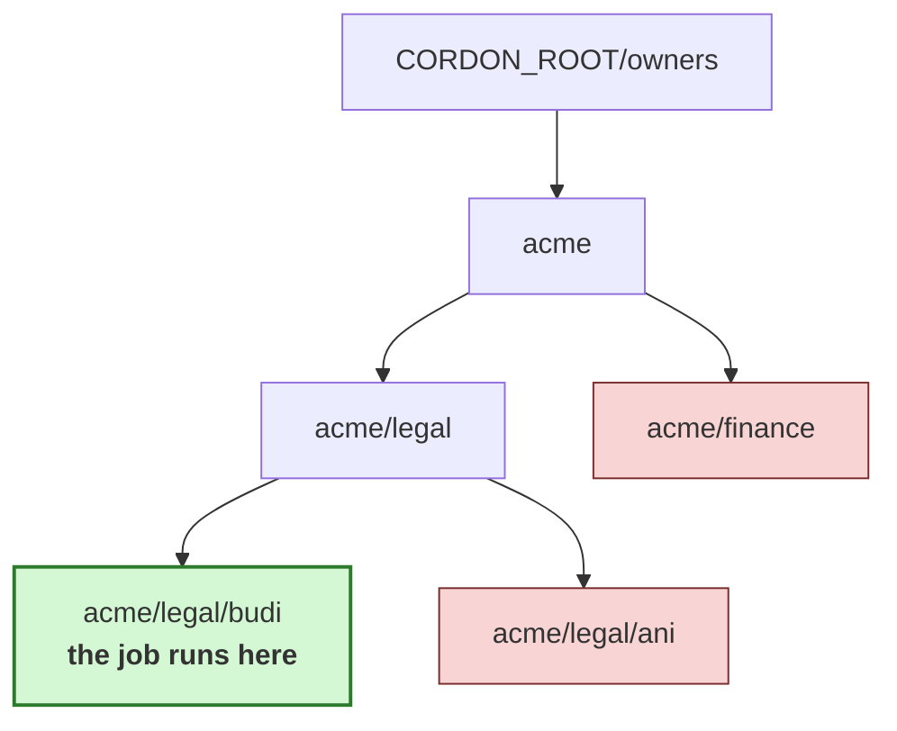

# cordon

**A sandbox per person. One binary, no KVM, no VM, runs on a 1 GB VPS.**

cordon gives every user, team and AI agent its own sandbox on disk, and decides
whether a path the model chose belongs to the session it came from.



> ### Every finding from the adversarial review is closed.
>
> A review on 3 Oct 2026 broke the isolation claim in five places and found
> nine more issues. All fourteen are fixed, each with a regression test, and
> each closed issue carries its own reproducer and what changed. Read
> [them](https://github.com/fajarhide/cordon/issues?q=is%3Aissue+is%3Aclosed)
> before trusting any of this. Several are counterexamples to designs that look
> obviously right, and [#21](https://github.com/fajarhide/cordon/issues/21)
> carries the two lessons that cost the most.
>
> The last one changed the API rather than the code. The egress allowlist
> blocked name resolution and left every address reachable, measured on a real
> host, so it was removed: a job now has `"network": "none"` or
> `"network": "open"`, and open means open.

## Quick start

```bash
cargo install --git https://github.com/fajarhide/cordon
cordon demo
```

`cordon demo` needs no daemon, no Docker and no configuration. It builds two
sandboxes, plants the traps a real job would plant, and tries to break out of
one into the other.



<details>
<summary>The same output as text</summary>

```
cordon demo
  root      /tmp/cordon-demo-72540
  owner a   demo/owner-a
  owner b   demo/owner-b   holds secret.md
  planted   a/peek and a/theirs, both symlinks into b

owner a reads its own file
  ok        notes.md -> /tmp/cordon-demo-72540/owners/demo/owner-a/notes.md

owner a cannot read owner b, nine ways
  refused   parent then sibling          path_escapes_workspace
  refused   many parents                 path_escapes_workspace
  refused   absolute path                absolute_path_rejected
  refused   symlink to their file        path_escapes_workspace
  refused   symlink to their directory   path_escapes_workspace
  refused   percent encoded              path_escapes_workspace
  refused   backslash separator          path_escapes_workspace
  refused   parent hidden mid path       path_escapes_workspace
  refused   nul byte smuggled in         path_escapes_workspace

9 of 9 attempts refused
```

</details>

Owner a has a symlink sitting in its own sandbox pointing straight at owner b's
file. It still cannot read it, because cordon resolves the path on the
filesystem first and judges where it actually landed. Checking the string is
what symlinks are for.

Then run the daemon:

```bash
cordon serve
```

A 1.3 MB static binary, six dependencies, no runtime and no container needed.

## What is cordon?

A sandbox harness for the era where software decides which file to open.

Every agent runtime eventually builds this layer, badly, in a hurry. A tool call
arrives with a path the model chose, and something has to decide whether that
path belongs to the user whose session it came from. Do it in the application
and you reimplement it per language, per service, and get it subtly wrong in one
of them.

cordon is that decision, in one place, behind an HTTP call:

- **A sandbox per owner.** `acme/legal/budi` gets a directory. It is the only one that owner can reach.
- **One guard.** Every path is resolved on disk and then judged. No string matching, no blocklist.
- **Two sandbox backends.** A process with rlimits for code you wrote, a locked-down container for code you did not.
- **Output by token.** A job's files come back as opaque tokens bound to one owner, never as paths.
- **Proof on demand.** `cordon verify` fires the attacks at your own running daemon and exits non-zero if any of them lands.

It is not a hypervisor and never claims to be. It shares the host kernel, which
is the trade that lets it run where KVM is not available.

## Why we built cordon

Two measurements, taken on a real deployment, decided the design.

**The sandbox is not the expensive part.** At 100 concurrent users the sandbox
runtime came to 0.15% of the monthly bill. The model was 99.85%. Compute inside
a turn was 0.03% of its wall clock: 8 ms building a spreadsheet against 96
seconds of model time. So paying for a VM per session buys isolation at a price
the workload never justified.

**Nested virtualisation was not available anyway.** Not on the VPS, not on the
dev box, not on any host checked. One provider advertised it; its DMI table said
KVM while `systemd-detect-virt` said the machine was itself a guest. A design
that needs `/dev/kvm` is a design that does not deploy.

**And the boundary that mattered was missing.** The agent runtime in use
guaranteed isolation between organisations and said nothing at all about
isolation between users inside one. Attachments pooled into a single shared
directory per agent, 19 MB of it, while the files that genuinely belonged to
individual users totalled 1.2 MB. Nobody chose that. It was just where the
default landed.

cordon is what was missing: a per-user boundary that works on a small VPS,
enforced by something the model cannot argue with.

## Built for teams

- **Ownership is a path, not a flag.** `acme/legal/budi` is one owner, `acme/legal` is another. Your tenancy maps onto it directly: org, team, person; or just a user id.
- **A member reaches up, never sideways.** With `inherit: true`, an owner sees the files sitting directly in its parent and grandparent sandboxes. A sibling is refused, always, with no list of who the siblings are.
- **Templates by fork.** `POST /v1/fork` copies a sandbox to a new owner, never overwriting one, and drops symlinks rather than carrying them across an owner boundary.
- **Per-owner limits with an operator ceiling.** A request may lower a limit and can never raise it past the one the operator set.
- **Nothing to run per person.** A sandbox is a directory. Ten thousand owners cost ten thousand directories, not ten thousand VMs.

## Architecture

Three things happen here. A path the owner owns resolves. A path that leaves the
sandbox is stopped at the guard and never reaches the filesystem. And a job runs
in a backend, writes into its own sandbox, and cannot see a sibling's even
though it is the one holding the file handle.



<details>
<summary>The same thing as a static diagram</summary>



</details>

Four pieces, and only the first one matters:

- **The guard** (`src/guard.rs`) is the product. It joins the requested path onto the owner's sandbox, resolves the result on the filesystem, and only then decides. It caches nothing, because a job can plant a symlink between two calls.
- **The backends** (`src/exec/`) run a job. Two of them, picked by who wrote the code being run.
- **The token store** (`src/artifact.rs`) hands a job's output back without ever handing out a path. A token carries no owner and no path inside it, so one cannot be constructed by guessing a filename.
- **The clients** (`clients/`) build requests and read answers. They hold no security logic at all, because a rule implemented twice is a rule that drifts.

### How an owner maps onto disk



<details>
<summary>The same thing as a static diagram</summary>



</details>

A job owned by `acme/legal/budi` reaches everything under the green box. With
`inherit: true` it also reaches the files sitting directly in `acme/legal` and
`acme`, and nothing deeper. The red boxes are refused, always.

That asymmetry is deliberate. The ownership tree is the directory tree, so every
subdirectory of `acme/legal` either is or could later become another owner.
Granting an ancestor's whole subtree would therefore grant the sibling, which is
the one thing cordon promises not to do.

## The sandbox

What one job gets, and what it does not.

**A filesystem.** Its own sandbox directory, as its working directory and its
`HOME`. Nothing above it, beside it, or outside the root, however the path is
spelled.

**A clock and a ceiling.** A wall-clock timeout that takes the whole process
tree, a memory cap, an output cap that truncates and says so rather than
buffering a runaway job into the daemon's heap.

**No network, in the container backend.** `--network none` by default. A job that
needs to reach something names it, host and port, and gets exactly those names
resolvable and no resolver for anything else.

**No root.** The container backend runs the job as the daemon's own uid, never
as root, and refuses to run at all if cordon itself is root.

**Output it cannot address.** Files are collected by pattern and handed back as
tokens. Present a token as a different owner and the answer is byte identical to
one for a token that never existed, so it does not even confirm the token is
real.

## API

Six endpoints. You can adopt the first one alone and stop there.

| | |
| --- | --- |
| `POST /v1/resolve` | may this owner touch this path, and does it exist |
| `POST /v1/run` | run a job in the owner's sandbox, collect its output |
| `GET /v1/artifact/{token}` | fetch one collected file by token |
| `POST /v1/fork` | copy a sandbox to a new owner, never overwriting |
| `POST /v1/token` | issue a token scoped to an owner prefix, operator only |
| `GET /v1/health` | liveness |

### The cheapest way to adopt it

Ask before you open a file. No job execution, no container, no change to how
your code reads files.

```bash
$ curl -s -X POST localhost:7777/v1/resolve -H 'content-type: application/json' \
    -d '{"owner":["acme","budi"],"path":"notes.md"}'
{"exists":true,"resolved":"/var/lib/cordon/owners/acme/budi/notes.md"}

$ curl -s -X POST localhost:7777/v1/resolve -H 'content-type: application/json' \
    -d '{"owner":["acme","budi"],"path":"../ani/secret.md"}'
{"error":{"code":"path_escapes_workspace","detail":{"path":"../ani/secret.md"},
          "message":"the path resolves outside the owner workspace"}}
```

### Run a job in a sandbox and get its output back

```bash
$ curl -s -X POST localhost:7777/v1/run -H 'content-type: application/json' -d '{
    "owner":["acme","budi"],
    "entrypoint":"sh",
    "args":["-c","mkdir -p out; printf hello > out/report.txt; echo done"],
    "collect":["out/*"],
    "backend":"container",
    "network":"none",
    "limits":{"wall_ms":5000,"memory_mb":128,"stdout_kb":64}
  }'
{"artifacts":[{"bytes":5,"path":"out/report.txt",
               "token":"art_ca0a49fb851175de1a08cb0dba96ddc2"}],
 "duration_ms":15,"exit_code":0,"network":"none","stderr":"","stdout":"done\n",
 "truncated":false}

$ curl -s 'localhost:7777/v1/artifact/art_ca0a49fb851175de1a08cb0dba96ddc2?owner=acme/budi'
hello

$ curl -s 'localhost:7777/v1/artifact/art_ca0a49fb851175de1a08cb0dba96ddc2?owner=acme/ani'
{"error":{"code":"artifact_not_found","message":"no such artifact"}}
```

### Two applications, one daemon

`CORDON_TOKEN` can name any owner. A scoped token can name the owners at or
under one prefix, and only the operator token can issue one.

```bash
$ curl -s -X POST localhost:7777/v1/token -H "authorization: Bearer $CORDON_TOKEN" \
    -H 'content-type: application/json' -d '{"prefix":["acme"]}'
{"prefix":"acme","token":"tok_5b0e..."}

$ curl -s -X POST localhost:7777/v1/resolve -H 'authorization: Bearer tok_5b0e...' \
    -H 'content-type: application/json' -d '{"owner":["other","budi"],"path":"notes.md"}'
{"error":{"code":"owner_outside_token_scope",
          "message":"this token is scoped to an owner prefix that does not contain that owner"}}
```

The scope holds on every endpoint that names an owner. A fork needs both ends
inside it, an artifact belonging to another prefix answers like one that never
existed, and `inherit` stops at the prefix instead of reaching the owners above
it. The prefix is compared a segment at a time, so `acme2` is not inside `acme`.

A token is a file under `CORDON_ROOT/tokens`, mode 600. It does not expire, and
deleting the file revokes it.

### Network

```json
{ "network": "none" }                                       // the default for a container
{ "network": "open", "hosts": { "db.internal": "10.0.0.5" } }
```

`none` or `open`, and the response reports which one the job actually got. The
`hosts` pins put names in the container's hosts file; they are a convenience for
reaching an internal service by name and restrict nothing. An address, not a
magic name: `host-gateway` meant different things on different network backends
and failed the container outright under rootless podman with netavark.

A request still sending the old `egress` field is refused with
`egress_removed` rather than translated, so a caller learns the promise changed
instead of inheriting it.

### Error codes

Every refusal carries a stable `code`, so a caller branches on that rather than
on prose.

| code | status | |
| --- | --- | --- |
| `unauthorized` | 401 | no bearer token, the wrong one, or a revoked one |
| `owner_outside_token_scope` | 403 | a scoped token named an owner outside its prefix |
| `operator_token_required` | 403 | a scoped token tried to issue a token |
| `invalid_owner` | 400 | a segment the daemon or the filesystem will not take |
| `absolute_path_rejected` | 400 | paths are relative to the owner workspace |
| `path_escapes_workspace` | 403 | the path resolved outside it |
| `invalid_request` | 400 | the body, a network value, or a host pin |
| `limit_exceeded` | 400 | a limit is zero or above the operator's ceiling |
| `egress_removed` | 400 | the old field, which was never a boundary |
| `backend_below_floor` | 400 | a request asked for weaker isolation than configured |
| `backend_cannot_honour_request` | 400 | that backend cannot do what was asked |
| `spawn_failed` | 400 | the entrypoint could not be started |
| `backend_unavailable` | 503 | the container runtime is down, or the image is absent |
| `artifact_not_found` | 404 | unknown token, wrong owner, expired, or no owner given |
| `destination_exists` | 409 | a fork would overwrite a workspace |
| `source_not_found` | 404 | the owner being forked has no workspace |

Four codes are 5xx and each one means the daemon rather than the request:
`workspace_unavailable`, `fork_failed`, `artifact_mint_failed`,
`token_issue_failed`. A full disk, a
read-only filesystem, a permission problem on `CORDON_ROOT`. Nothing a caller
sends should produce one, and if it does, that is a bug worth an issue.

## One use case, end to end

An agent renders a report for Budi. Budi collects it. Ani presents the same
token and is refused, and Ani's own job cannot find the file either, because
inside its sandbox that file does not exist.


Five beats, all real: the request Budi's app sends, the token that comes back
instead of a path, the bytes for the owner it belongs to, a `404` for anyone
else, and a job of Ani's reaching for the path directly and finding nothing
there.

## Integrating with an agent runtime

The whole integration is one call in front of your file tool.

```ts
import { Cordon, CordonError } from "@cordon/client";

const cordon = new Cordon("http://127.0.0.1:7777");

// Your existing read_file tool, with one line in front of it.
async function readFile(session: Session, path: string) {
  try {
    const { resolved, exists } = await cordon.resolve(session.owner, path);
    if (!exists) return { error: "file not found" };
    return { content: await Bun.file(resolved).text() };
  } catch (e) {
    // The model asked for someone else's file. Tell it no and carry on; this
    // is a normal turn, not an incident.
    if (e instanceof CordonError) return { error: e.code };
    throw e;
  }
}
```

The same call from Ruby, with the client under `clients/ruby`:

```ruby
# Gemfile
gem "cordon-client", git: "https://github.com/fajarhide/cordon", glob: "clients/ruby/*.gemspec"
```

```ruby
require "cordon"

CORDON = Cordon::Client.new("http://127.0.0.1:7777")

def read_file(session, path)
  found = CORDON.resolve(session.owner, path)
  return { error: "file not found" } unless found["exists"]

  { content: File.read(found["resolved"]) }
rescue Cordon::Error => e
  { error: e.code }
end
```

`session.owner` is whatever your tenancy already looks like: `["acme", "budi"]`,
`["org_42", "team_legal", "u_991"]`, a single `["u_991"]`. cordon does not care,
as long as it is the same array every turn for the same user.

`resolve` returns the canonicalised path it checked, so the name you open is the
one that was approved. It is still not a capability: a component created between
the answer and the open is outside what any path string can promise. For a job
that writes files, prefer `/v1/run`, where the boundary is enforced on the
process rather than agreed with it.

## Prove it on your own box

`cordon verify` fires path-string attacks at a daemon you are already running
and exits non-zero if one lands.

It writes a secret as one owner and has another owner's job try to read it, by
every shape the review used. It checks authentication, the parent-child owner
pair, the backend floor, all three ways of asking for an artifact, and a token
scoped to one owner pointed at everything that is not that owner.


<details>
<summary>The same run as text, from CI on Linux, abridged in the middle</summary>

```
$ cordon verify http://127.0.0.1:7777 $CORDON_TOKEN

ok   no credentials refused           status 401, code unauthorized
ok   a wrong token refused            status 401, code unauthorized
ok   parent traversal                 status 403, code path_escapes_workspace
ok   absolute path                    status 400, code absolute_path_rejected
ok   percent encoded                  status 403, code path_escapes_workspace
ok   dotdot owner                     status 400, code invalid_owner
ok   non ascii owner                  status 400, code invalid_owner
ok   uppercase owner                  status 400, code invalid_owner
ok   reach the token store            status 403, code path_escapes_workspace
ok   parent reaches its child         status 403, code path_escapes_workspace
ok   parent reaches the child leaf    status 403, code path_escapes_workspace
ok   a job cannot read another owner  the job ran and could not reach it
ok   an artifact needs its owner      status 404 with no owner
ok   an artifact refuses another owner status 404, same body as a bare fetch
ok   an artifact works for its owner  the owner got its own bytes
ok   a weaker backend is refused      status 400, code backend_below_floor
ok   a zero memory limit is refused   status 400, code limit_exceeded
ok   scoped: its own prefix works     status 200 for its own owner
ok   scoped: another owner refused    status 403, code owner_outside_token_scope
ok   scoped: a lookalike refused      status 403, code owner_outside_token_scope
ok   scoped: no inherit above it      status 403, code path_escapes_workspace
ok   scoped: no fork across           status 403, code owner_outside_token_scope
ok   scoped: cannot issue tokens      status 403, code operator_token_required

all 29 checks passed
```

</details>

On a daemon configured for the process backend the floor check reports
`skip  a weaker backend is refused   this daemon is configured for the process
backend, so there is no floor to test`, which is what a skip is for.

**A check it cannot run reports as `skip`, never as a pass.** That distinction is
the point. The first version of this tool passed 9 of 9 against a daemon that
leaked every owner's file, because it probed `/v1/resolve` with two same-depth
owners and counted anything 4xx as a win, including the `401` from a daemon it
had no credentials for. A run where nothing passed now exits non-zero, because a
pipeline reading exit 0 on an all-skip run is back where it started.

A 403 with an empty body does not count as a pass either. A check passes only on
a 4xx that carries a machine readable code, because a reverse proxy in front of
a broken daemon returns exactly a bodiless 403.

The probes live under the owner prefix `cordon-verify`, which is reserved for
them. Nothing in the API deletes an owner, so they stay on disk unless verify is
told where the daemon keeps its files:

```bash
cordon verify http://127.0.0.1:7777 $CORDON_TOKEN --root /var/lib/cordon
```

That removes `owners/cordon-verify` after a passing run and keeps it after a
failed one, which is the one time you want to look at it.

## Trust model

Worth stating plainly, because the README used to imply something stronger.

**The calling application is trusted to name any owner.** The token
authenticates your app, not your end user. A caller that can reach the daemon
can run a job as `acme/ani` just as easily as `acme/budi`, so `/v1/fork`
copying any sandbox is not a separate hole: a caller that can `run` as an owner
can already read that owner's files.

**The boundary cordon enforces is between jobs, not between callers.** Your app
decides which owner a request belongs to, from its own session or token. cordon
makes sure the job that then runs cannot step outside the sandbox that owner was
given, whatever path the model picked.

So: put the daemon on a unix socket or loopback, keep `CORDON_TOKEN` out of
anything a user controls, and derive the owner array in your own code rather
than taking it from a request body.

Two applications sharing a daemon do not have to trust each other: give each a
token scoped to its own owner prefix. Inside its prefix an application is still
trusted to name any owner, exactly as above.

## What is guaranteed, and what is not

The gaps are in the table too. A table of only wins is a table nobody believes.

| | process backend | container backend |
| --- | --- | --- |
| one owner cannot read another's files | yes, Landlock, Linux 5.13+ | yes |
| a hardlink to another owner's file | not collected, link count checked | cannot cross the mount |
| symlink out of the sandbox refused | yes | yes |
| wall clock and output size capped | yes | yes |
| memory capped | `RLIMIT_AS`, advisory on macOS | yes, cgroup |
| filesystem outside the sandbox | no, Landlock allowlist | no, read-only root |
| network | host network, always open | none by default, `open` on request |
| outbound filtering | **none, and none offered** | **none, and none offered** |
| runs as root | as the daemon's user | no, and refuses if cordon is root |
| available without Landlock | **no, the job is refused** | yes |
| kernel level escape | shares the host kernel | shares the host kernel |

Two rows to read twice.

The **process backend has no network isolation**. It is for code you wrote, on a
box where that is already true. Asking it for `"network": "none"` is a refusal,
not a silent grant.

**There is no outbound filtering anywhere in v1.** A container job has no
network or the host's full outbound access, nothing between. v0 shipped an
"egress allowlist" that attached a bridge and set `--dns 0.0.0.0`; measured on a
real host, a job with one allowlisted entry still reached `8.8.8.8:53` directly.
`--dns` is not a packet filter. The feature is gone rather than documented,
because a field named `egress` promising a boundary it does not have is worse
than not offering one. A per-job network namespace with nftables rules is the
real answer and is a v2 item.

cordon shares the host kernel either way. A kernel level escape defeats it and
nothing here claims otherwise. If your threat model needs a hypervisor, you need
a hypervisor.

One more gap, in the ownership model rather than the sandbox: a shared team
subtree is out of reach in v1, for the reason given under Architecture. A team
that needs one is its own owner, or you fork the template into the member's
sandbox.

## Which backend

**process**, the default. One process, working directory pinned to the sandbox,
scrubbed environment, rlimits applied between fork and exec, its own session so
a timeout takes the children too, and a Landlock ruleset applied to the child
before it execs so its filesystem view is the sandbox plus the system paths it
needs to start. Needs Linux 5.13 or later; refuses to run a job without it.
Runs on a 1 GB VPS with nothing installed.

**container**, `CORDON_BACKEND=container`. Needs Docker or podman, named by
`CORDON_CONTAINER_CLI`. Never needs KVM or nested virtualisation.

cordon does not pull images: pull `CORDON_IMAGE` yourself before pointing jobs
at it. A job's stderr belongs to the job, and a pull in the middle of one puts
registry progress in it. A missing image is a 503 `backend_unavailable` naming
the command to run.

Under podman the container gets `--userns keep-id`, because rootless podman maps
container uids to host subuids and without it the job cannot write to its own
bind-mounted sandbox. docker needs no equivalent: its daemon runs as root, so
the uid in `--user` is a host uid already. `--network none`,
`--read-only`, `--cap-drop ALL`, `--security-opt no-new-privileges`,
`--pids-limit 128`, and a `noexec` tmpfs for scratch. The job runs as the
daemon's own uid, which is what keeps the bind-mounted sandbox writable from both
sides.

Pick by who wrote the code. Yours: process. The model's, or your customer's:
container.

If Docker is down, a container job answers 503 `backend_unavailable`. It never
silently falls back to the process backend, because that hands a caller weaker
isolation than it asked for without telling it. For the same reason
`CORDON_BACKEND` is a floor rather than a default: a request may ask for a
stronger backend than the operator configured and never a weaker one.

## Configuration

| variable | default | |
| --- | --- | --- |
| `CORDON_ROOT` | `/var/lib/cordon` | where sandboxes live |
| `CORDON_LISTEN` | `unix:/run/cordond.sock` | or `tcp:127.0.0.1:7777` |
| `CORDON_TOKEN` | unset | required for a non loopback listener |
| `CORDON_BACKEND` | `process` | or `container` |
| `CORDON_IMAGE` | `alpine:3.20` | the container backend's image |
| `CORDON_CONTAINER_CLI` | `docker` | or `podman`. Plenty of hosts have one and not the other |
| `CORDON_ARTIFACT_TTL` | `24h` | `s`, `m`, `h` or `d`. Expired records are deleted at startup and every hour after |
| `CORDON_MAX_WALL_MS` | `60000` | ceiling a request may lower, never raise |
| `CORDON_MAX_MEMORY_MB` | `1024` | same |
| `CORDON_SYSTEM_PATHS` | `/usr:/bin:/sbin:/lib:/lib64:/etc:/dev/null:/dev/urandom:/dev/zero` | read and execute inside the Landlock boundary. Never add `/tmp` or `/var`: `CORDON_ROOT` usually lives under one |
| `CORDON_UNSAFE_PROCESS_BACKEND` | unset | `1` lets the process backend run with no boundary. Development only, and every such job says so on its stderr |

The daemon refuses to start on a listener the network can reach with no token.
That is not a warning in a log, it is an exit.

`packaging/cordond.service` is a systemd unit with `ProtectSystem=strict` and a
dedicated user, and a comment saying plainly that the container backend needs
that user in the `docker` group, which is equivalent to root on the host.

## Local development

```bash
cargo test                                      # 133 tests
cargo test --test footprint -- --nocapture      # the 20 MB claim, measured
cargo clippy --all-targets -- -D warnings
cargo check --target x86_64-unknown-linux-gnu   # Linux is the target platform
cd clients/typescript && bun test               # 9 tests
ruby clients/ruby/test/cordon_test.rb           # 10 tests, stdlib only

# the container backend, against either runtime. CORDON_REQUIRE_DOCKER makes a
# skipped container test a failure, which is how CI stops coverage lapsing.
docker pull alpine:3.20 && CORDON_REQUIRE_DOCKER=1 cargo test
podman pull alpine:3.20 && podman tag docker.io/library/alpine:3.20 alpine:3.20
CORDON_CONTAINER_CLI=podman CORDON_REQUIRE_DOCKER=1 \
  cargo test --bin cordon exec::container
```

CI runs on a Linux runner against **both** runtimes on every push: a container
job starts, writes to its sandbox, and is confirmed to have no network, under
docker and under rootless podman. A container test that skips there fails the
build, so coverage cannot quietly lapse.

Running both is not belt and braces. Three bugs only ever appeared under
rootless podman: cordon called `docker` unconditionally, the old `host-gateway`
pin failed the container outright under netavark, and without `--userns keep-id`
a job could not write to its own sandbox. The last one passes on a Mac, because
podman machine maps uids differently.

The recordings in this README are generated, not hand made, so they cannot drift
from what the binary does:

```bash
vhs tapes/demo.tape        # and verify.tape, usecase.tape
python3 tapes/architecture.py /tmp/archframes
python3 tapes/hero.py /tmp/heroframes     # and owners.py
```

`tapes/serve.sh` starts the daemon the two live recordings talk to. The
architecture, hero and owner animations are SVG frames rendered with `rsvg-convert` and
assembled with `ffmpeg`; the command is in the header of `tapes/hero.py`.

Footprint, measured by `tests/footprint.rs`, which starts the release binary,
waits for it to answer, sends it 50 requests, checks it is still answering, and
reads its RSS:

```
daemon RSS while serving: 4768 KB
test result: ok. 1 passed
```

The budget is 20 MB and it is a test, not a sentence. It also has a floor of 1
MB, because the first version accepted any reading above zero and once passed on
a 32 KB reading for a daemon whose real RSS was 2768 KB. A test that carries a
claim has to fail when it cannot measure, not when the number happens to be
small.

## Security

133 tests, and four mutations each confirmed to break the suite.

The lesson from the review is worth more than the count: the two modules with
the heaviest test coverage, `src/guard.rs` and `src/owner.rs`, were not the
layer guarding the data on `/v1/run`, which went around them entirely. A
thoroughly tested module proves nothing about a code path that does not call
it.

| mutation | result |
| --- | --- |
| the path check forced to pass | 3 passed, 5 failed |
| the on-disk resolution skipped | 5 passed, 3 failed |
| ancestor reach forced on | 7 passed, 1 failed |
| the nul, percent and backslash rejection dropped | 7 passed, 1 failed |

`src/guard.rs` is the file to read if you read only one. Its tests are written as
attacks rather than as examples.

The fixture in `src/testsupport.rs` only ever builds two owners at the same
depth, which is why issue #2 survived every one of those tests.

Found a way past it? Open an issue with the path string. A reproducer is worth
more than a report.

## Licence

The daemon is AGPL 3.0. Run it, embed it, put it behind your product: the licence
only asks that if you modify the daemon itself and offer it over a network, you
publish those modifications.

The clients under `clients/` are Apache 2.0, so linking one into a closed source
application needs nothing from you.
